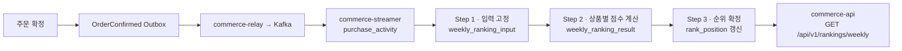
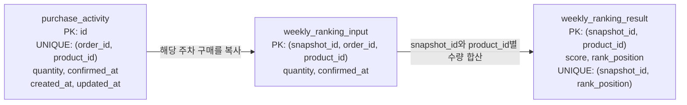

# 9주차 주간 구매 랭킹 설계

주문 확정으로 쌓인 구매 활동을 주 단위로 집계한다. 집계가 중간에 멈추면 같은 입력에서 마지막 커밋 다음부터 이어서 처리하고, 고객은 상품별 순위까지 확정된 결과를 조회한다.

## 과제에서 지켜야 할 동작

| 요구사항 | 구현에서 확인할 지점 |
| --- | --- |
| 실제 구매 활동으로 주간 점수 계산 | 주문 최초 확정 시각 `confirmed_at`으로 UTC 월요일 00:00 이상, 다음 월요일 00:00 미만의 활동을 고른다. 상품별 구매 수량을 합산한다. |
| 같은 JobInstance 재시작 | 실패한 실행과 동일한 `periodStart`, `revision`을 넘긴다. 완료한 입력 고정 Step을 건너뛰고 점수 Step의 저장된 위치에서 이어 간다. |
| 늦게 도착한 구매 반영 | 원래 주차의 새 리비전을 실행해 구매 활동을 다시 고정한다. 새 순위가 커밋되는 시점에 조회 결과가 바뀐다. |
| 결정적인 순위와 공개 경계 | 점수 내림차순, 동점이면 상품 ID 오름차순으로 순위를 매긴다. 순위가 채워진 결과만 API에 노출한다. |
| 재시작과 정상 실행 비교 | 고정 입력과 상품별 점수·순위, 커밋된 체크포인트를 비교한다. |

실습의 API 계약과 통합 검증 중 남은 항목은 [검증 기록의 제출 체크리스트](weekly-ranking-verification.md#제출-전-확인할-항목)에 기록했다.

## 구매 활동에서 랭킹까지

구매 활동의 단위는 주문과 상품의 조합이다. 한 주문에 상품 7과 상품 8이 있으면 입력도 두 행이 된다. 점수 계산에서는 같은 상품의 수량을 합칠 수 있도록 상품 하나를 청크의 한 항목으로 읽는다. [구매 활동 consumer](../week6/purchase-consumer.md)

## 테이블 구조와 보관

`snapshot_id`는 주차와 리비전을 담는다. `periodStart=2026-08-17`, `revision=1`이면 `weekly-2026-08-17-r1`이다. 입력과 결과는 이 키로 연결되고, 결과 한 행은 해당 스냅샷의 상품 하나를 나타낸다. 여러 주차와 리비전의 결과가 쌓일 수 있다. API의 100건 제한은 응답에 적용한다.

새 입력을 고정할 때 이미 순위가 공개된 스냅샷의 구매 입력을 정리한다. 같은 주의 새 리비전을 실행할 때도 정리할 수 있다. 순위가 공개되기 전에 실패한 스냅샷의 입력은 재시작에 쓰며, 공개된 상품별 점수와 순위는 결과 테이블에 보관한다. [랭킹 스키마](../../apps/commerce-batch/src/main/resources/db/weekly-ranking.sql)

## 실행과 공개 경계

| 단계 | 처리와 커밋 |
| --- | --- |
| 입력 고정 | 주간 활동을 `INSERT … SELECT`로 복사한다. Step의 실행 컨텍스트에 고정 여부를 기록해 구매가 0건인 입력도 재진입 시 그대로 사용한다. |
| 점수 계산 | StepScope Reader가 스냅샷의 상품 ID를 중복 없이 오름차순으로 읽는다. Processor는 같은 스냅샷의 수량 합을 계산한다. Writer는 `(snapshot_id, product_id)`에 절대 점수를 upsert한다. 청크 커밋 경계에 점수 저장과 Reader 위치 기록이 있다. |
| 공개 | 고정 입력의 상품 수를 확인하고 모든 결과 행의 순위를 한 트랜잭션에서 채운다. 갱신 행 수가 예상과 다르면 롤백한다. 이미 순위가 확정된 스냅샷을 다시 공개하면 기존 순위를 사용한다. |

점수 Step은 청크마다 결과를 남겨 실패한 지점부터 이어갈 수 있다. 이때 `rank_position`은 아직 `NULL`이다. 공개 Step이 모든 순위를 커밋하면 API 조회 대상이 된다. 두 단계로 줄이려면 점수·순위를 한 번에 계산해 공개할 수 있지만, 집계 실패 시 계산 전체를 다시 실행하게 되므로 이번에는 청크 재시작을 유지했다. [Job 구성](../../apps/commerce-batch/src/main/kotlin/com/loopers/batch/job/ranking/WeeklyRankingJobConfig.kt) · [공개 Step](../../apps/commerce-batch/src/main/kotlin/com/loopers/batch/job/ranking/step/publish/WeeklyRankingPublishTasklet.kt)

`ranking.chunk-size`의 기본값은 상품 100개다. 재시작 실험은 청크 경계를 확인할 수 있도록 2로 실행했다.

공개 리비전은 결과 테이블의 순위가 확정된 행에서 조회 시점에 고른다. 한 SQL이 스냅샷 하나를 선택하고 그 스냅샷의 상품만 가져간다. 같은 주에 `r2`가 공개된 뒤 `r1`이 완료돼도 숫자가 더 큰 `r2`가 조회된다. [조회 SQL](../../apps/commerce-api/src/main/kotlin/com/loopers/ranking/infrastructure/JdbcWeeklyRankingRepository.kt)

## 현재 API 계약

`GET /api/v1/rankings/weekly?periodStart=2026-08-17&limit=10`

| 항목 | 현재 동작 |
| --- | --- |
| `periodStart` | 필수. `YYYY-MM-DD` 형식의 UTC 월요일이다. |
| `limit` | 선택. 1~100의 정수이며 기본값은 10이다. 올바르지 않은 날짜나 범위는 HTTP 400이다. |
| 응답 | `data` 배열에 실제 조회 주차의 `periodStart`, `productId`, `score`, `rank`를 반환한다. |
| 조회할 순위가 없는 경우 | 요청 주차에 순위가 없으면 직전 주차의 랭킹을 조회한다. 두 주차 모두 순위가 없으면 빈 배열을 반환한다. |

`scheduler` 프로필은 기본적으로 매주 월요일 00:00 UTC에 직전 주의 `revision=1`을 실행한다. 같은 작업을 다시 시작하거나 늦은 구매로 재계산할 때는 대상 주차와 리비전을 직접 지정한다. [실행과 검증](weekly-ranking-verification.md)
