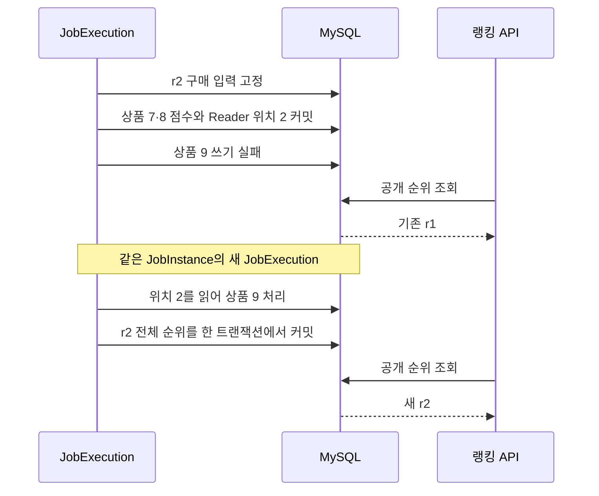

# 주간 랭킹 배치가 실패한 상품부터 이어 가려면

상품 7·8의 점수를 저장한 다음 상품 9를 쓰다가 배치를 실패시켰다. 첫 실행의 마지막 커밋에는 점수 두 행과 Reader 위치 2가 남았다. 같은 주차와 리비전으로 시작한 두 번째 실행은 상품 9만 읽고 최종 순위를 공개했다. [실행과 관찰값](weekly-ranking-verification.md#실패와-재시작-관찰)

## 같은 주차에도 두 종류의 실행이 있다

주차는 주문이 최초 확정된 시각으로 결정한다. 월요일 집계가 시작된 뒤 지난주에 확정된 주문이 들어오면, 같은 시간 조건으로 다시 조회한 결과에도 새 주문이 포함될 수 있다. 처리 위치만 복구하고 원본 구매를 다시 읽으면 앞에서 저장한 점수와 뒤에서 계산한 점수의 입력 기준이 달라진다.

JobInstance는 Job 이름·`periodStart`·`revision`으로 구분한다. 첫 실행과 실패 후 재시작은 이 값이 같아서 여러 JobExecution이 하나의 JobInstance에 연결된다. 이미 복사한 구매 입력도 같은 `snapshot_id`로 읽는다. 늦은 주문을 포함할 때는 원래 주차의 리비전을 올려 새 JobInstance를 만들고 입력을 다시 복사한다.

## 어디까지 끝났다고 말할 수 있나

Reader의 정렬 순서는 상품 ID 오름차순으로 고정했다. 그래서 같은 입력에서 위치 2는 앞의 두 상품이 끝났다는 뜻이다. 실행이 실패할 때 로그에는 상품 9까지 읽었다는 숫자 3이 찍혔다. 재시작에 사용한 값은 DB에 저장된 `WEEKLY_RANKING_PRODUCT_READER.read.count=2`였다. 읽은 횟수와 커밋된 위치는 실패 지점에 따라 달라질 수 있다.

청크를 다시 처리할 때도 점수를 덧셈으로 갱신하면 결과가 달라진다. Writer는 고정 입력에서 구한 합계로 점수를 덮어쓴다. 상품 7의 구매 수량이 2개와 3개라면 같은 행을 다시 써도 5점이다. 상품별 유일 키와 고정 입력이 함께 이 동작을 보장한다.

## 점수를 저장한 뒤 순위를 확정하는 이유

앞의 두 상품만 커밋된 시점에는 세 번째 상품이 몇 위인지 알 수 없다. 이때 API가 점수 행을 읽으면 재시작에 필요한 중간 결과가 고객에게 노출된다. 점수 계산이 끝난 뒤 별도 Step에서 전체 상품에 순위를 부여한다. 이 트랜잭션이 끝날 때까지 API는 이전 공개본을 읽는다.

집계와 공개를 한 트랜잭션에서 처리하는 방법도 검토했다. 이번에는 중간 커밋부터 이어 가는 것이 과제의 목적이어서 점수와 공개를 나눴다. 스냅샷 입력을 별도로 복사하는 저장 비용이 생기므로, 공개된 리비전의 입력은 다음 신규 스냅샷에서 정리한다. 그 이후 과거 리비전에서 직접 조회할 수 있는 업무 데이터는 상품별 점수·순위다. [설계와 API 계약](weekly-ranking-design.md)
